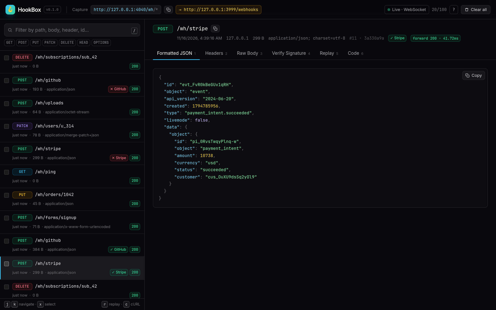
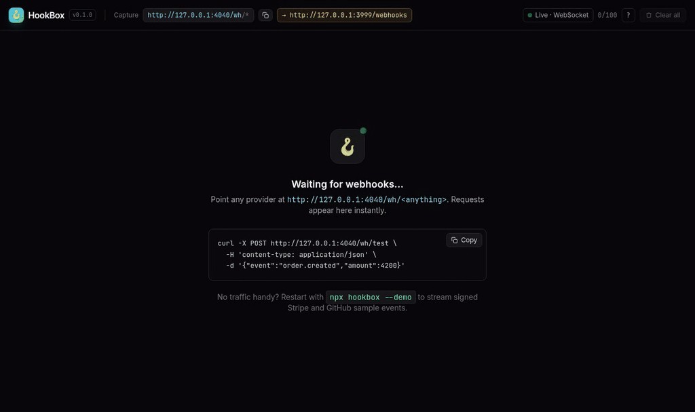
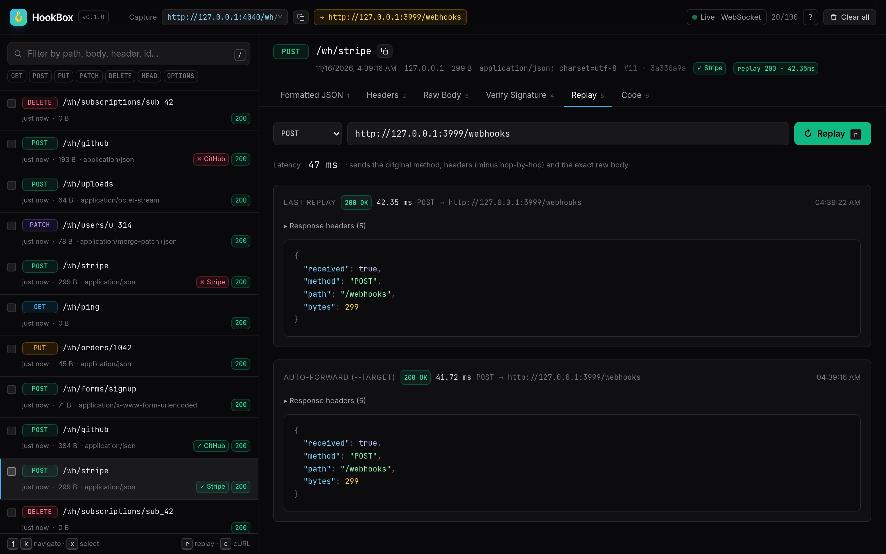
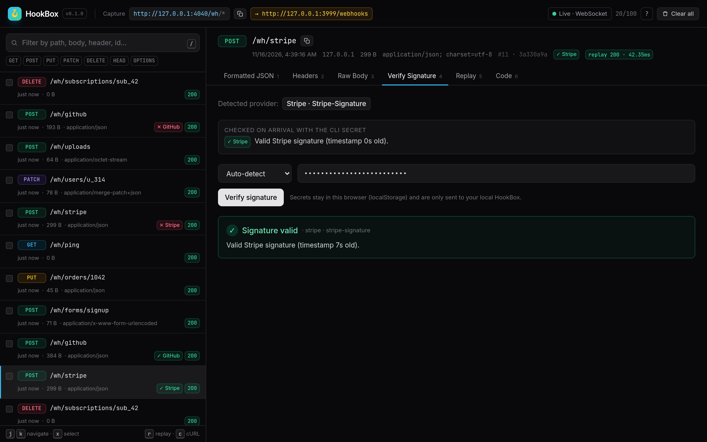
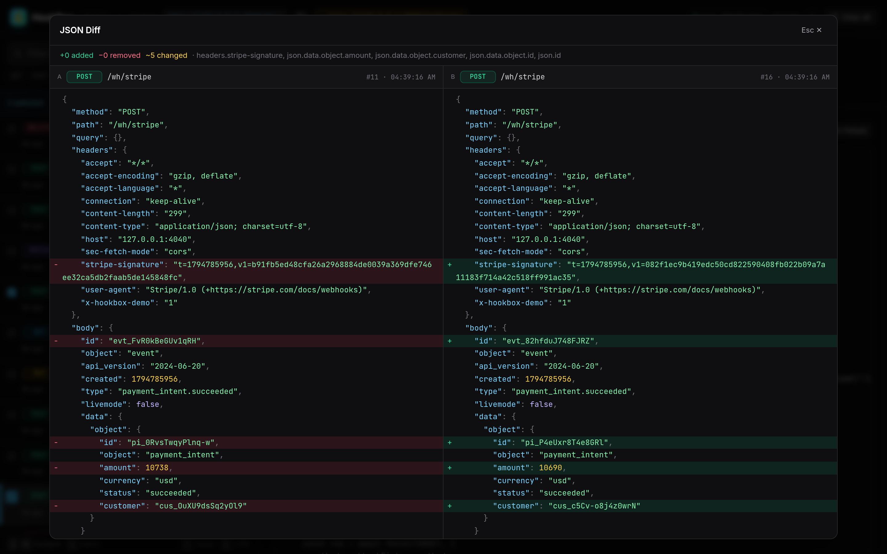
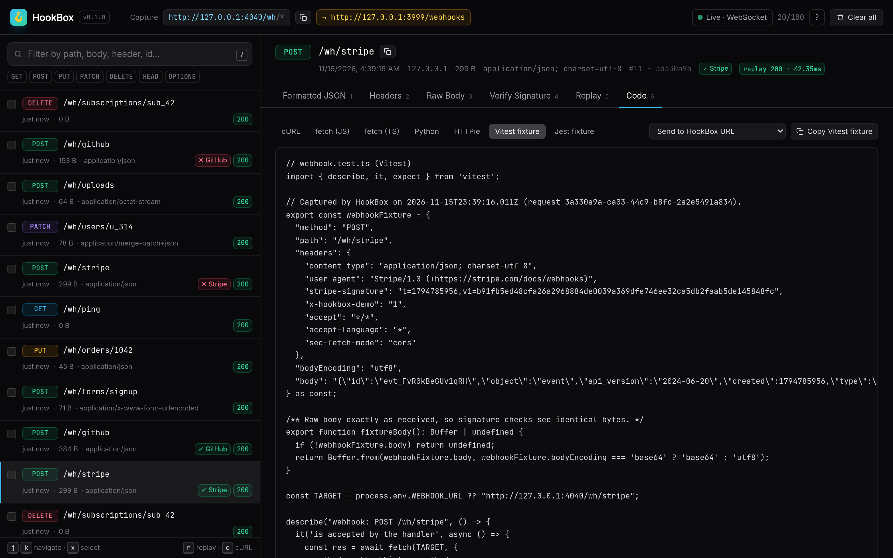
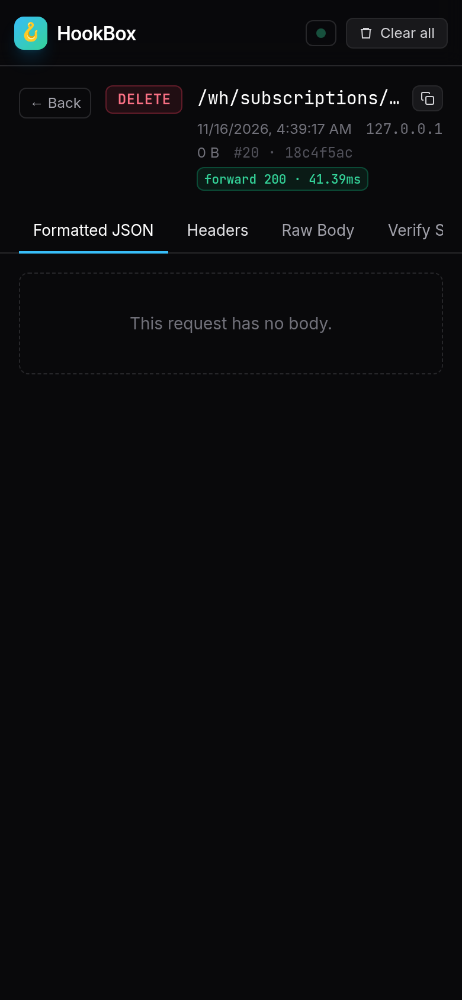
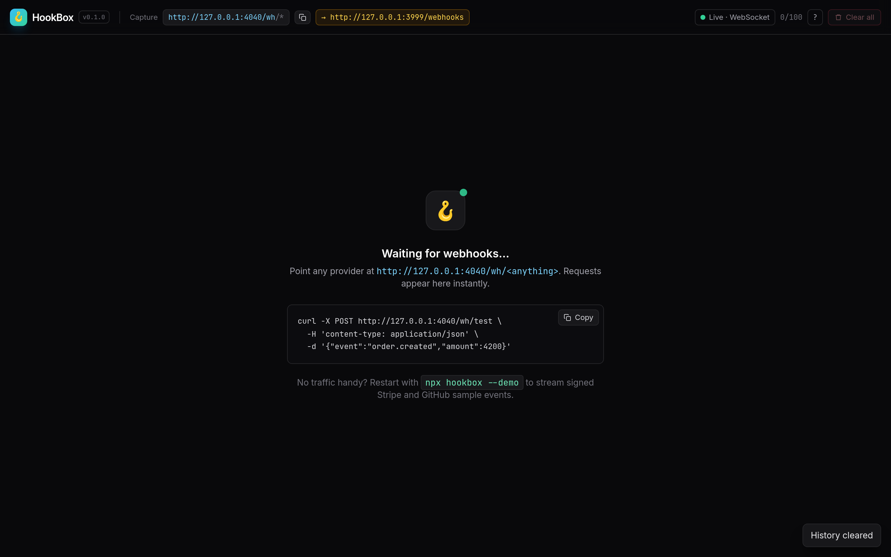

<div align="center">

# 🪝 HookBox

### Catch, inspect, verify and replay webhooks on your own machine. One command, no account, no Docker.

An open-source, local alternative to Webhook.site and RequestBin, with replay, a Stripe and GitHub signature checker, and a live dashboard.

[](LICENSE)
[](https://nodejs.org)
[](tsconfig.json)
[](#-contributing)

[Quickstart](#-10-second-quickstart) · [Features](#-features) · [Comparison](#-how-it-compares) · [CLI](#-cli-flags) · [API](#-http-api) · [Signatures](#-signature-verification) · [Roadmap](#-roadmap)

<br />



</div>

<!-- DEMO GIF PLACEHOLDER: record a 10–15s terminal + dashboard demo, save it as docs/demo.gif and replace this block with:
<p align="center"></p>
-->
> 🎬 **Demo GIF coming soon.** *(Placeholder: `docs/demo.gif`, showing `npx … --demo`, requests streaming in, a replay and a signature check.)*

---

## ⚡ 10-second quickstart

HookBox isn't on npm yet, so run it straight from GitHub (Node 20+):

```bash
npx github:reseachrandomv/hookbox --demo
```

Open **http://localhost:4040**. `--demo` streams signed sample Stripe, GitHub, form and binary webhooks so you can explore right away. Drop it to wait for real traffic:

```bash
npx github:reseachrandomv/hookbox
curl -X POST http://localhost:4040/wh/test \
  -H 'content-type: application/json' \
  -d '{"event":"order.created","amount":4200}'
```

**Clone, build and run:**

```bash
git clone https://github.com/reseachrandomv/hookbox.git
cd hookbox
npm install        # also builds dist/ through the prepare script
node dist/cli.js --demo
npm test           # end-to-end smoke tests
```

> Once HookBox is published to npm, this becomes simply `npx hookbox`.

---

## ✨ Features

- **Catch everything.** `GET`, `POST`, `PUT`, `PATCH`, `DELETE`, `HEAD` and `OPTIONS` on `/wh` and `/wh/*`, with any content type. HookBox keeps the exact raw bytes (base64 for binary), parsed JSON or form data, headers, query, IP, timestamp and size.
- **Live dashboard.** A split-pane, dark UI that updates over WebSocket and falls back to Server-Sent Events. Method pills, status badges, search and method filters, all with no frontend build step.
- **One-key replay.** Send any captured request to `http://localhost:3000/...` with its original method, headers and raw body. You get the status, headers, body and **latency in ms**. You can also change the method or headers.
- **Auto-forward.** `--target <url>` proxies every incoming webhook to your app in the background and records each response.
- **Signature verification.** Checks Stripe `Stripe-Signature` and GitHub `X-Hub-Signature-256`. When a check fails, HookBox says why: wrong secret, edited body, expired timestamp, malformed header or wrong provider.
- **Export as code.** cURL, fetch (JS), fetch (TS), Python `requests`, HTTPie, plus ready-to-run **Vitest** and **Jest** test fixtures built from the real payload.
- **JSON diff.** Tick two requests to compare them side by side. Volatile headers such as `date` and `content-length` are ignored in the summary.
- **Optional persistence.** `--db hooks.db` stores history in SQLite (built-in `node:sqlite`, or `better-sqlite3`). If neither is available, it falls back to memory.
- **Ring buffer.** `--max-history` (default 100) keeps memory flat.
- **Public URL (optional).** `--tunnel` opens a localtunnel or cloudflared URL and health-checks it before showing it ([details below](#-public-tunnel-honest-notes)).
- **Keyboard first.** `j`/`k`, `r`, `/`, `c` and `Esc`, plus more listed below.
- **Small and local.** Three runtime dependencies (Fastify, ws, commander). It binds to `127.0.0.1` by default.

<table>
  <tr>
    <td width="50%"><br /><sub><b>Replay</b>: latency timer, status and response body</sub></td>
    <td width="50%"><br /><sub><b>Verify Signature</b>: paste a secret and the provider is detected</sub></td>
  </tr>
  <tr>
    <td width="50%"><br /><sub><b>JSON Diff</b>: compare two requests side by side</sub></td>
    <td width="50%"><br /><sub><b>Code export</b>: cURL, fetch, Python, HTTPie, Vitest and Jest</sub></td>
  </tr>
</table>

<p align="center">
  
  &nbsp;&nbsp;
  
</p>

---

## 🥊 How it compares

| | **HookBox** | ngrok Inspector | Webhook.site | RequestBin (Pipedream) |
|---|---|---|---|---|
| Where your data lives | Your machine | Local agent UI (a cloud Traffic Inspector also exists) | Their cloud (or self-host the open-source edition) | Their cloud |
| Account needed | No | Yes, for the ngrok agent | No for basic use | For private bins |
| Open source | ✅ MIT | ❌ agent is closed source | ✅ MIT edition (fewer features than the cloud) | ❌ hosted service |
| Setup | `npx` one-liner | Install agent and sign in | Open a website, or Docker for self-host | Open a website |
| Public URL | Optional (`--tunnel`) | ✅ core feature | ✅ | ✅ |
| Replay to localhost | ✅ with latency | ✅ (with modifications) | Via their `whcli` forwarder | Not a focus |
| Stripe / GitHub signature check | ✅ built in, with failure reasons | Edge verification via Traffic Policy (cloud) | Via custom scripting (paid features) | Via Pipedream workflow code |
| Code and test-fixture export | ✅ cURL, fetch, TS, Python, HTTPie, Vitest, Jest | Not a focus | Not a focus | Not a focus |
| JSON diff of two requests | ✅ | Not a focus | Not a focus | Not a focus |
| Works offline / on a plane | ✅ (local capture) | ❌ | ❌ (unless self-hosted) | ❌ |

<sub>Based on each vendor's public docs as of November 2026. The other three also do things HookBox doesn't (hosted URLs that last, team sharing, cloud workflows), and plans and limits change, so check each vendor's site before deciding. Corrections welcome via PR.</sub>

---

## 🛠 CLI flags

```text
hookbox [options]
```

| Flag | Default | Description |
|---|---|---|
| `-p, --port <number>` | `4040` | Port for the dashboard and capture endpoint (`HOOKBOX_PORT`) |
| `--host <host>` | `127.0.0.1` | Interface to bind; `0.0.0.0` exposes it on your LAN (`HOOKBOX_HOST`) |
| `-t, --target <url>` | none | Auto-forward every captured request to this URL (`HOOKBOX_TARGET`) |
| `-m, --max-history <number>` | `100` | Ring-buffer size (`HOOKBOX_MAX_HISTORY`) |
| `--db <file>` | none | Persist requests to SQLite (`HOOKBOX_DB`) |
| `--stripe-secret <whsec>` | none | Verify `Stripe-Signature` on arrival (`HOOKBOX_STRIPE_SECRET`) |
| `--github-secret <secret>` | none | Verify `X-Hub-Signature-256` on arrival (`HOOKBOX_GITHUB_SECRET`) |
| `--tunnel [provider]` | off | Public URL: `auto` (localtunnel, then cloudflared), `localtunnel` or `cloudflared` |
| `--demo` | off | Send signed sample traffic to yourself |
| `--demo-interval <ms>` | `2500` | Delay between demo requests |
| `--demo-count <n>` | unlimited | Stop the demo after `n` requests |
| `--body-limit <bytes>` | `10485760` | Maximum request body size (10 MiB) |
| `--no-banner` | | Skip the start-up banner |
| `--no-log` | | Don't log each request to the terminal |
| `-v, --version` / `-h, --help` | | Version and help |

**Examples**

```bash
npx github:reseachrandomv/hookbox --target http://localhost:3000/api/webhooks/stripe
npx github:reseachrandomv/hookbox --stripe-secret whsec_xxx --github-secret s3cret
npx github:reseachrandomv/hookbox --db ./hooks.db --max-history 500
npx github:reseachrandomv/hookbox --tunnel cloudflared
```

---

## ⌨️ Keyboard shortcuts

| Key | Action |
|---|---|
| `j` / `↓` | Next request |
| `k` / `↑` | Previous request |
| `/` | Focus search / filter |
| `r` | Replay the selected request |
| `c` | Copy as cURL |
| `x` | Select the request for diff |
| `d` | Open JSON diff (2 selected) |
| `1`–`6` | Switch tab (JSON, Headers, Raw, Verify, Replay, Code) |
| `Esc` | Close modal / clear search / clear selection |
| `?` | Show shortcuts |

---

## 🔌 HTTP API

Everything the dashboard does is also available over a small JSON API on the same port.

| Method | Endpoint | Description |
|---|---|---|
| `ANY` | `/wh`, `/wh/*` | Capture endpoint. Replies `200 {"ok":true,"id":…}` with CORS enabled |
| `GET` | `/api/requests` | List requests, newest first. Query: `method=POST,PUT`, `q=text`, `limit=n` |
| `GET` | `/api/requests/:id` | One captured request |
| `DELETE` | `/api/requests` | Clear history |
| `POST` | `/api/requests/:id/replay` | Body: `{"target":"http://…","method?":"PUT","headers?":{"x-a":"1","x-b":null},"timeoutMs?":5000}`. Returns status, headers, body and `durationMs` |
| `POST` | `/api/requests/:id/verify` | Body: `{"secret":"whsec_…","provider?":"auto\|stripe\|github"}`. Returns `{valid, provider, reason}` |
| `GET` | `/api/requests/:id/curl` | Plain-text cURL. Query: `target=` to point it elsewhere, `format=json` |
| `GET` | `/api/requests/:id/code` | `lang=curl\|fetch\|typescript\|python\|httpie\|vitest\|jest\|all`, optional `target=` |
| `GET` | `/api/diff?a=<id>&b=<id>` | Structural diff. Add `all=1` to include volatile headers |
| `GET` | `/api/events` | Server-Sent Events stream with heartbeat |
| `WS` | `/api/ws` | WebSocket stream (same events) |
| `GET` | `/api/info`, `/api/health` | Version, settings, persistence status, tunnel URL |

Events: `request.created`, `request.updated` (replay, forward), `request.removed` (ring-buffer eviction), `requests.cleared`.

---

## 🔐 Signature verification

Webhook providers sign each delivery so your server can prove it's genuine. Most "my webhook fails" bugs come down to the signature: the wrong secret, or a framework that re-serialised the JSON before checking it. HookBox checks against the **exact raw bytes it received**, so you can tell which side is at fault.

**Stripe** sends `Stripe-Signature: t=<unix>,v1=<hex>`. HookBox computes `HMAC-SHA256(secret, "<t>.<raw body>")`, compares it in constant time against every `v1`, then checks the timestamp is within **300 s** to block replays.

**GitHub** sends `X-Hub-Signature-256: sha256=<hex>`. HookBox computes `HMAC-SHA256(secret, raw body)`. The legacy `X-Hub-Signature` (sha1) is accepted too, with a note.

There are two ways to verify:

1. **On arrival:** start with `--stripe-secret` / `--github-secret`. Every request gets a ✓ or ✕ badge in the feed and in the terminal log.
2. **After the fact:** open **Verify Signature**, paste a secret, and HookBox detects the provider. The secret stays in your browser's localStorage and is only sent to your local HookBox.

Failure reasons it reports:

| Situation | Reason shown |
|---|---|
| Body changed or wrong secret | *Signature mismatch: the body was modified, or the signing secret is wrong* |
| Stripe timestamp too old | *Signature matched but the timestamp is outside the 300s tolerance (possible replay attack or clock skew)* |
| Broken header | *Malformed Stripe-Signature header: missing timestamp / no v1 signature* |
| Provider mismatch | *Provider stripe selected, but the request has no Stripe-Signature header* |
| Unsigned request | *No signature header found* |

> Replays and exported snippets resend the **original** signature. Stripe signatures expire after 5 minutes, so to test a replay against a real Stripe SDK, loosen the tolerance in development or re-sign the payload.

---

## 🌍 Public tunnel (honest notes)

You don't need a tunnel for local testing. You only need one when a third party (Stripe, GitHub, Shopify…) has to reach your laptop.

- `--tunnel` (or `--tunnel auto`) first tries **localtunnel**, bundled as an optional dependency and only loaded when you ask for it. Then it tries a **cloudflared quick tunnel** (`*.trycloudflare.com`) if the `cloudflared` binary is on your `PATH`, or set `HOOKBOX_CLOUDFLARED=/path/to/cloudflared`.
- Getting a URL isn't proof the tunnel works. HookBox **calls `/api/health` through the tunnel** before showing the URL. If traffic doesn't come back, it closes that tunnel, tries the next one, and the banner explains each failure.
- **Some networks block tunnels.** Corporate proxies, some CI sandboxes and locked-down VPNs can stop localtunnel's relay ports or cloudflared's edge connection (QUIC/HTTP2 on port 7844). In our own sandboxed build environment both providers handed out URLs that never connected, and HookBox correctly reported them as unreachable. On a normal home or office connection they usually work.
- Both are free, best-effort public services with no uptime guarantee. For anything important, use your own tunnel (named cloudflared tunnel, ngrok or Tailscale Funnel) and point it at `localhost:4040/wh/...`.

---

## 🗺 Roadmap

- [ ] Publish to npm (`npx hookbox`)
- [ ] More verifiers: Shopify, Slack, Twilio, Svix / Standard Webhooks
- [ ] Custom responses per path (status, body, delay) to test provider retries
- [ ] Re-sign on replay (fresh Stripe timestamps)
- [ ] Export / import sessions (HAR / JSON)
- [ ] Request search across the persisted SQLite history
- [ ] Docker image and Homebrew formula
- [ ] Recorded demo GIF for this README

Have an idea? [Open an issue](https://github.com/reseachrandomv/hookbox/issues).

---

## 🤝 Contributing

PRs are very welcome, especially new signature verifiers, code exporters and UI polish.

```bash
git clone https://github.com/reseachrandomv/hookbox.git && cd hookbox
npm install            # installs and builds
npm run dev            # tsc --watch
node dist/cli.js --demo
npm test               # end-to-end smoke tests against the built CLI
```

- The backend lives in `src/` (TypeScript, strict): `server.ts`, `store.ts`, `verifier.ts`, `replay.ts`, `codegen.ts`, `diff.ts`, `tunnel.ts`, `demo.ts` and `cli.ts`.
- The dashboard is one no-build file, `public/index.html` (Preact + HTM + Tailwind via CDN).
- Please add or extend a check in `scripts/smoke-test.mjs` for any behaviour you change.

---

## 📄 License

[MIT](LICENSE). Free for personal and commercial use.

<div align="center"><sub>Built by <a href="https://github.com/reseachrandomv">@reseachrandomv</a>. If HookBox saved you a debugging session, a ⭐ helps others find it.</sub></div>
